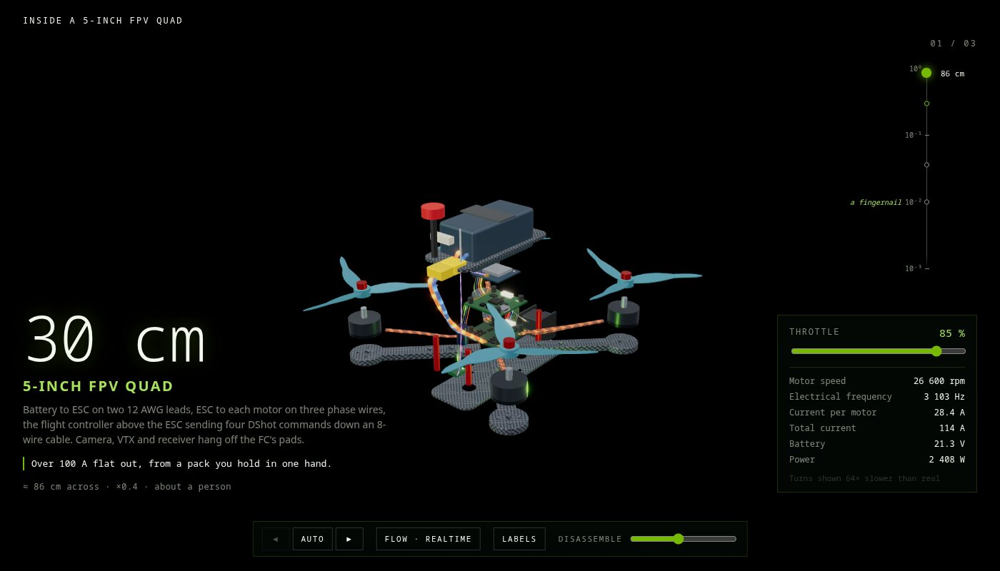
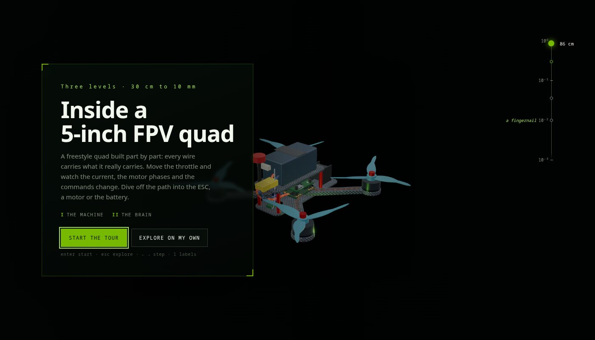
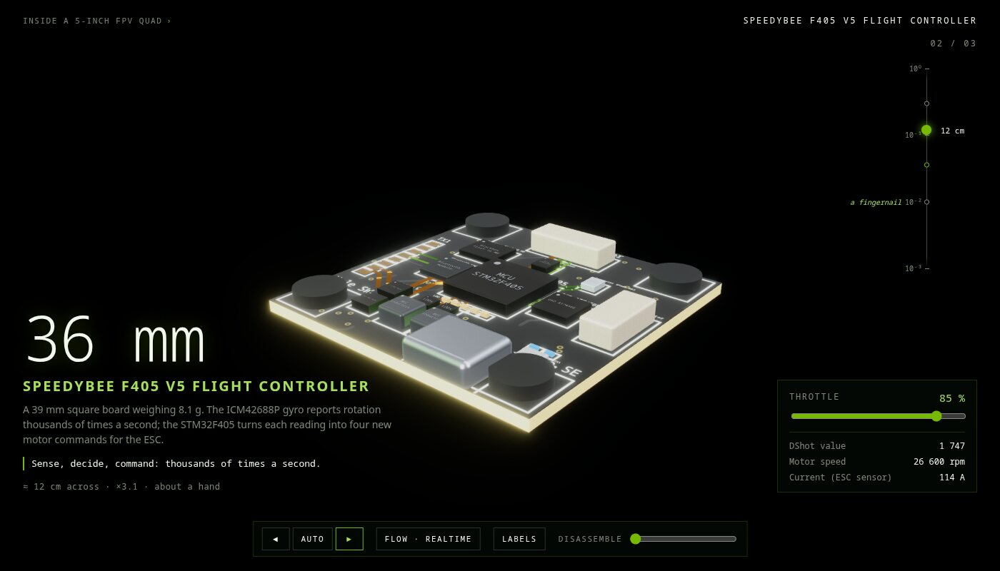

<h1 align="center">3Disle</h1>

<p align="center">
  <b>Make explorable 3D teardowns of real hardware, without writing the page by hand.</b><br />
  Created by <b>f3nt</b>
</p>

<p align="center">
  
</p>

**Try it:** download [`demo/fpv-quad.html`](demo/fpv-quad.html) (one file, about 1 MB) and open it
in a browser. No install, no server: the whole teardown is inside the page.

That page is a 5-inch FPV quad built entirely from 3Disle's engine, part by part from
datasheets. Every wire carries what it really carries: battery leads, three phases per motor,
DShot commands, video, RF. Move the **throttle** and the props spin up, current streams through
the leads, the motor coils glow in phase and the readouts (rpm, electrical Hz, amps, watts)
follow. **Disassemble** pulls the stack apart while the wires stretch with it. The tour then
**dives** into the flight controller and down to its STM32F405, 30 cm to 10 mm; off the path
you can open the ESC, a motor or the battery.

<p align="center">
  
  
</p>

## What 3Disle is

3Disle turns 3D models of a device and its parts into a teardown you explore in the browser.
You take it apart layer by layer, open a part to see what is inside, and dive level by level
from the whole device down to a single chip. Its look and feel follow
[GPU → Atom](https://olehhavrilko.github.io/3dgpuanimation/), a hand-built descent from a
graphics card to a silicon atom.

You bring the models (from Blender, as GLB) or describe the device in JSON: which pieces are
parts, what each one is, which part opens into which deeper model, and how power, data and
motion run through it. The engine does the rest, and `npm run export` turns any teardown into
a finished page: a folder to host, or one `.html` that opens from disk.

## Run it

```bash
npm ci
npm run dev        # the start page, every tour and model, the editor
npm run demo       # rebuild demo/fpv-quad.html from the current code and data
```

Details and checks: [INSTALL.md](INSTALL.md). How it works:
[docs/ARCHITECTURE.md](docs/ARCHITECTURE.md); every field a device file can use:
[docs/ENGINE.md](docs/ENGINE.md); where it stands: [docs/STATE.md](docs/STATE.md).

[MIT](LICENSE)
