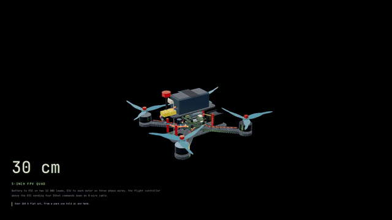
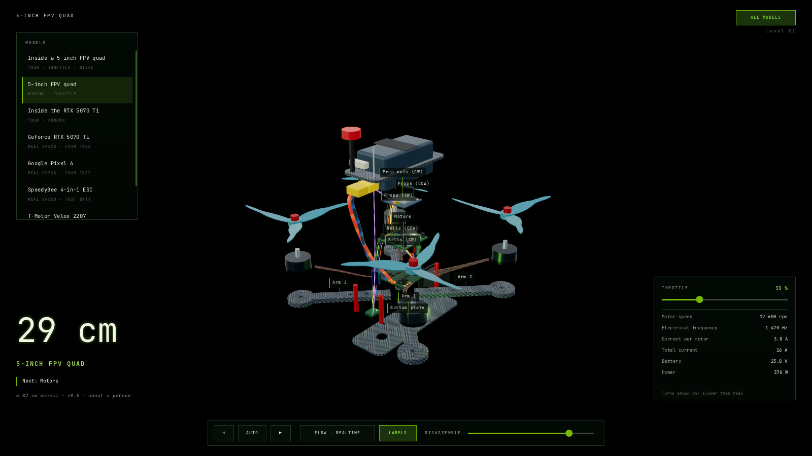

<h1 align="center">3Disle</h1>

<p align="center">
  <b>Explorable 3D teardowns and explainer videos of real hardware, from plain data.</b><br />
  Created by <b>f3nt</b>
</p>

<p align="center">
  
</p>

Describe a device in JSON, part by part from its datasheets. 3Disle builds it in 3D, lets you take
it apart and dive from the whole machine down to a single chip, and writes and renders the video.
It is a small C program on the GPU: no browser, no runtime, no `node_modules`.

```sh
3disle auto public/models/drone/tour.json quad.shot.json   # write a video's timeline from the data
3disle render quad.shot.json -o quad.mp4                   # render it, frame by exact frame
```

An 82-second 720p video renders in about 6 seconds on an RTX 5070 Ti. Every frame is a pure
function of its time, so two renders of the same moment are identical.

<p align="center">
  
</p>
<p align="center">
  
  
</p>

## Status

| | |
| --- | --- |
| Engine, renderer, viewer, tours, dives, labels, throttle | **Working, in C** |
| Timeline format, automatic videos, MP4 rendering | **Working, command line** |
| Editor: build a device and animate it on a timeline | Next |
| One-file web export, GLB models and projects | Planned; for now they live in [`legacy-ts/`](legacy-ts/) |

Details: [docs/STATE.md](docs/STATE.md) and [docs/PLAN.md](docs/PLAN.md).

## Build

Linux, with a C compiler, SDL3, EGL and OpenGL ES 3 headers; ffmpeg to render video.

```sh
make            # build/3disle
make test       # engine checks; needs no screen or GPU
build/3disle    # open the viewer on the quad tour
```

More: [INSTALL.md](INSTALL.md). How it works: [docs/ARCHITECTURE.md](docs/ARCHITECTURE.md). Every
field a device file can use: [docs/ENGINE.md](docs/ENGINE.md).

## Devices are data

```json
{
  "name": "Main PCB",
  "footprint": [303, 121],
  "layers": [{
    "name": "Top copper + mask", "thickness": 0.1, "surface": "pcb",
    "parts": [{ "name": "GDDR7", "shape": "box", "size": [14, 1.1, 12], "material": "chip",
                "repeat": { "count": 3, "step": [28, 0] } }]
  }]
}
```

Included: a 5-inch FPV quad with its real wiring, an RTX 5070 Ti from card to die, a Pixel 6.

[MIT](LICENSE) · [third-party notices](third_party/NOTICES.md)
